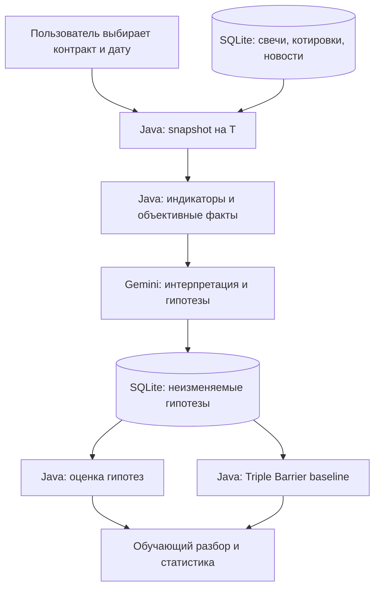

# Centaur Trading — корректировка плана MVP

**Для агента разработки.** Основание: `reference.md` (Centaur-Backtester), `analysis.md` (индикаторы MVP) и уточнённая цель продукта. Это задание на **пересмотр существующего плана**, а не на немедленное переписывание кода.

## 1. Цель продукта

Centaur — персональный AI-наставник и исследовательская лаборатория по рынку фьючерсов MOEX. Пользователь **сам выбирает** конкретный контракт (интересуют зерно, медь, кофе, золото, серебро; фактическую доступность контрактов нужно проверить). Система объясняет реальные индикаторы, учитывает доступный на момент анализа новостной контекст, формирует **проверяемые рыночные гипотезы** и помогает учиться на их последующей проверке.

**Не делать:** автоторговлю, реальные ордера, автоматический скрининг/выбор активов, обещания доходности. Рекомендации должны быть сценарными: что наблюдать, что подтвердит гипотезу, что её опровергнет, когда лучше воздержаться от вывода.

## 2. Задание агенту

1. Изучи репозиторий, текущий план и уже реализованные части. Не предполагай, что все блоки из спецификации существуют в коде.
2. Подготовь таблицу **сохранить / изменить / добавить / отложить**, оценку сложности и зависимости.
3. Предложи минимальные совместимые изменения архитектуры и схемы SQLite. Не начинай рефакторинг до согласования плана.
4. Разделяй требования исходных документов, новые требования ниже и открытые вопросы.

## 3. Что сохраняется

- Java для вычисления индикаторов, правил и объективной оценки; SQLite для истории, запусков и результатов.
- Gemini для интерпретации фактов и объяснений; **не** для расчёта индикаторов или присвоения ground truth.
- EMA(20/50), RSI(14), ATR(28), Spread/ATR, уровни High/Low.
- Исторические срезы на момент `T`, structured JSON, журнал экспериментов.
- Triple Barrier `TP / SL / TIMEOUT` и фиксированные `SL=1×ATR`, `TP=2×ATR` как **контрольный эксперимент (baseline)**, а не единственную меру качества анализа.

## 4. Центральная сущность — MarketHypothesis, не Trade

Разделить:

- **InstrumentSpec:** код MOEX, серия/экспирация, тип контракта, базовый актив, валюта котирования/расчётов, тик и стоимость шага, расписание, источник данных.
- **MarketSnapshot:** неизменяемый срез доступных на `T` свечей, котировок, индикаторов, новостей и метаданных с timestamp и provenance.
- **MarketAnalysis:** интерпретация фактов, альтернативные объяснения и неопределённости.
- **MarketHypothesis:** проверяемое утверждение, тип сценария, горизонт, формальные условия подтверждения и опровержения, аргументация, альтернативный сценарий.
- **HypothesisEvaluation:** независимая оценка по будущим данным (`CONFIRMED`, `INVALIDATED`, `INCONCLUSIVE`, `NOT_EVALUABLE`).
- **VirtualTrade / BarrierEvaluation:** отдельная контрфактическая сделка (`TAKE_PROFIT`, `STOP_LOSS`, `TIMEOUT`, `AMBIGUOUS`), с учётом исполнения и издержек.

**Не приравнивать** верно определённое направление к прибыльной сделке: цена может продолжить рост, но сначала задеть близкий стоп.



## 5. Уточнение индикаторов

| Индикатор | Изменение |
|---|---|
| EMA(20/50) | Оставить spread и отклонение цены; добавить историю нескольких значений или изменение за `k` свечей. Пересечение — описание прошлого движения, не гарантия продолжения. |
| RSI(14) | Оставить значение; добавить краткую динамику. Расстояние до 30/70 — второстепенно; не интерпретировать как вероятность разворота. |
| ATR(28) | Оставить абсолютное и относительное значение, явно хранить таймфрейм и метод расчёта. Опционально сравнить с историческим ATR. |
| Spread/ATR | Оставить; добавить spread/mid-price и timestamp котировки. Это показатель части издержек, не полная оценка ликвидности. |
| High/Low | **Исправить терминологию:** `max(High, N=50)` и `min(Low, N=50)` — rolling-экстремумы, не обязательно ближайшие swing-экстремумы. Добавить confirmed Swing High/Low с формальным pivot-правилом. |

Для pivot (например, 2 свечи слева и 2 справа) сохранять **время подтверждения**: использовать экстремум в анализе можно лишь после появления правых свечей. Исключить look-ahead bias. Не называть rolling maximum «сильным сопротивлением» без отдельного критерия.

Не добавлять автоматически MACD, Stochastic и другие похожие индикаторы. Объём и Open Interest — возможный следующий этап при наличии надёжных данных.

## 6. Контракт Java → Gemini

Передавать **структурированные числа с единицами, параметрами, таймфреймом, временем доступности и источником**. Существующие текстовые шаблоны можно сохранить как производное представление, но не как единственный источник данных.

Концептуальный пример ответа (не окончательная JSON Schema):

```json
{
  "marketInterpretation": {
    "trend": "UP",
    "momentum": "POSITIVE",
    "evidence": ["EMA20 > EMA50"],
    "uncertainties": ["индикаторы не доказывают продолжение"]
  },
  "hypotheses": [{
    "type": "TREND_CONTINUATION",
    "statement": "Проверяемое описание сценария",
    "horizonBars": 10,
    "confirmationRules": [{"kind": "BREAK_ABOVE", "level": 13800}],
    "invalidationRules": [{"kind": "BREAK_BELOW", "level": 13400}],
    "alternativeScenario": "Коррекция в диапазоне",
    "reasoning": "Аргументы по конкретным фактам"
  }],
  "recommendation": "WAIT_FOR_CONFIRMATION",
  "learningNotes": ["Что означает комбинация показателей"]
}
```

Важнее всего **машинно-проверяемые правила**. Предложить небольшой типизированный DSL для условий (касание/пересечение уровня, последовательность подтверждённых свингов, горизонт). Не пытаться исполнять свободный текст. Непроверяемые формулировки отмечать `NOT_EVALUABLE`.

В интерфейсе и ответе отделять **факт → интерпретацию → гипотезу → альтернативы → условия проверки**. Слова «чаще всего» и конкретные вероятности использовать только при наличии исторически измеренной частоты с указанной выборкой и горизонтом. Иначе — «согласуется с», «традиционно интерпретируется как», «не гарантирует».

## 7. Исторический бэктестинг: обязательные гарантии

1. **As-of T:** никакой информации, опубликованной или подтверждённой после `T`, включая новости и правые свечи pivot.
2. Зафиксировать время принятия решения и входа: после закрытия `T` нельзя без оговорки исполнять сделку по close той же свечи.
3. Явно задать единицу горизонта: `10 календарных дней`, `10 сессий` и `10 баров` — разные вещи. H1/H4 и D1 не смешивать.
4. Если OHLC-свеча пересекла TP и SL, а внутрисвечной порядок неизвестен — `AMBIGUOUS` либо заранее объявленное консервативное правило; не выдумывать порядок.
5. Учитывать спред, комиссию, проскальзывание, тик и стоимость шага цены.
6. Рассчитывать baseline **независимо от решения Gemini**, включая отказанные сделки; иначе нельзя измерить упущенные возможности.
7. Хранить prompt version, model ID/version, параметры, полный вход/выход, snapshot ID, версию расчётов. `temperature=0` и `seed` не гарантируют точной повторяемости.
8. Для проверки эффективности выделять хронологически отложенную выборку; учитывать перекрывающиеся будущие окна.
9. Исторические новости должны иметь время фактической публикации. Не разрешать LLM неконтролируемый актуальный web-поиск во время исторического теста; учитывать возможные исторические знания самой модели.

## 8. MOEX: отдельные требования к данным

Проверять спецификации и доступность конкретных контрактов на зерно, медь, кофе, золото и серебро. Не предполагать, что все эти категории представлены одинаково. Не смешивать серии фьючерсов в индикаторах без явно выбранной методики ролловера/continuous series. Валютную зависимость и международный бенчмарк устанавливать по спецификации конкретного контракта, а не по общему правилу. Технический и новостной анализ хранить отдельно: совпадение новости и изменения цены не доказывает причинности. Если исторических новостей нет, показывать `newsContextUnavailable`, а не придумывать объяснение.

## 9. Метрики: отдельно гипотезы и сделки

**Качество гипотез:** доли `CONFIRMED / INVALIDATED / INCONCLUSIVE / NOT_EVALUABLE`, разбивка по инструменту, горизонту и типу сценария. Условия оценки должны быть зафиксированы **до** просмотра будущих данных.

**Качество виртуальных сделок:** win rate, expectancy **после издержек**, средний выигрыш/убыток, доли `TIMEOUT / AMBIGUOUS`, coverage (как часто LLM допускает вход), отфильтрованные убытки **и пропущенные выигрыши**. Сравнивать с baseline без LLM. Высокий avoidance ratio при постоянном `NO_TRADE` не считать успехом.

Целевые `55–60%` win rate из исходного документа — исследовательская гипотеза, **не критерий готовности MVP**. При идеализированном R:R 1:2 без издержек и timeout безубыточный win rate ≈33,3%; в реальности результат меняют издержки, исполнение и timeout.

**Обучение:** показывать исходные аргументы, фактический исход, что подтверждено/опровергнуто, где осталась неопределённость. Не переписывать гипотезу задним числом.

## 10. Предлагаемая последовательность работ

**Этап 0 — аудит.** Сопоставить код и план с требованиями, проверить источники данных, текущую схему SQLite, наличие контрактов и timestamps. Согласовать первый контракт, таймфрейм и горизонт.

**Этап 1 — достоверный snapshot.** InstrumentSpec, as-of данные, проверенные индикаторы, разделение rolling/pivot, тесты на look-ahead.

**Этап 2 — гипотезы.** Структурированный input/output, типизированные условия, неизменяемый журнал, обучающее объяснение.

**Этап 3 — независимая проверка.** HypothesisEvaluation и отдельно Triple Barrier с издержками, неоднозначными свечами и baseline.

**Этап 4 — отчёты.** Сравнение гипотез с исходами, анализ ошибок, упущенные возможности, история обучения. Point-in-time новости — при наличии надёжного источника.

## 11. Критерии приёмки MVP

- Пользователь вручную выбирает конкретную серию фьючерса MOEX.
- Исторический snapshot не содержит данных из будущего; тестами проверены pivot confirmation и доступность новостей.
- Индикаторы рассчитаны Java и покрыты эталонными тестами.
- Gemini выдаёт объяснение и формальные сценарии **или честно сообщает, что данных недостаточно**.
- Гипотеза сохраняется неизменной, отдельно от оценки и виртуальной сделки.
- Triple Barrier корректно обрабатывает timeout, неоднозначность OHLC и издержки.
- Отчёт показывает ошибки и упущенные возможности, сравнивает LLM с baseline.
- Система не выставляет реальные ордера и не выбирает активы самостоятельно.

## 12. Что агент должен вернуть владельцу

1. Краткую оценку текущего состояния репозитория относительно требований.
2. Обновлённый план задач по этапам с приоритетами и зависимостями.
3. Предлагаемые изменения схемы SQLite, Java DTO/API и JSON Schema Gemini.
4. Перечень тестов на корректность расчётов, отсутствие утечки будущих данных и воспроизводимость экспериментов.
5. Список **открытых решений** (первый контракт MOEX, источник данных, таймфрейм, горизонт, правила исполнения, новости), которые нельзя молча решить за пользователя.

**Главный принцип:** сначала обеспечить достоверность наблюдений и проверяемость гипотез, затем измерять их качество. Не оптимизировать продукт под выдачу красивых торговых сигналов.
