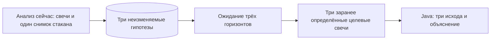

# Решение: проверка гипотез без постоянного опроса стакана

Уточнено 13 октября 2026 года. Этот файл объясняет пересмотр прежнего предложения о минутном сборщике. Основной план — `mvp-development-plan.md`, протокол оценки — `testing.md`.

## Цель наблюдения

Centaur подсказывает и объясняет, не ведёт сделку. Пользователь выбирает серию и timeframe; горизонты фиксированы: 1, 5 и 10 торговых дней MOEX от снимка рынка, причём день 1 — следующий торговый день. На каждом запуске анализа система сохраняет использованные закрытые свечи для индикаторов, Bid/Ask и доступные объёмы как показатель текущего спреда, времена и источники, полный запрос/ответ Gemini и три неизменяемые гипотезы `TERMINAL_PRICE_RANGE`. После закрытия соответствующих целевых свечей Java сравнивает их фактические `close` с прогнозными диапазонами. Получившийся набор наблюдений даёт статистику `HIT/MISS/NOT_EVALUABLE`, ширины диапазонов и ошибок отдельно по горизонту.

Для прогнозов диапазона `close` целевых свечей промежуточные снимки стакана не нужны. Снимок стакана после горизонта можно получить для сравнения условий, но он не подменяет `close` целевой свечи. Постоянный опрос Bid/Ask понадобился бы для иной задачи: моделировать внутрипериодное исполнение стопов/тейков или исследовать динамику ликвидности. Эта задача **не входит в первый MVP**. Событийные гипотезы вида «цена хотя бы раз превысит уровень» отложены.

## Финансовая статистика как отдельный вопрос

Если позже потребуется ответ «что было бы при условной покупке и удержании до горизонта», можно сравнить стартовый Ask и конечный Bid с заранее установленными комиссиями и допущением об исполнении. Для него хватит двух времён, но P&L будет **условным**, не фактически заработанным. Нельзя утверждать, что стоп или тейк исполнился по заданной цене, не имея нужных данных. Triple Barrier по будущим свечам можно использовать как отдельную разметку касаний, с `AMBIGUOUS` при неизвестном порядке внутри свечи; он не определяет исход рыночной гипотезы.

## Что остаётся согласовать

Конкретная серия MOEX и timeframe, технический контракт одного ответа Gemini с тремя прогнозами и обработка частичных ошибок. Для каждого горизонта целевой момент — конец основной сессии соответствующего торгового дня; берётся первая свеча выбранного timeframe, относящаяся к этой сессии и закрывшаяся не раньше целевого момента. Проверка назначается на следующий календарный день. Если серия истекает до десятого торгового дня, запуск отклоняется до Gemini. Частоту опроса стакана утверждать не нужно, поскольку фонового опроса в этом срезе нет.
