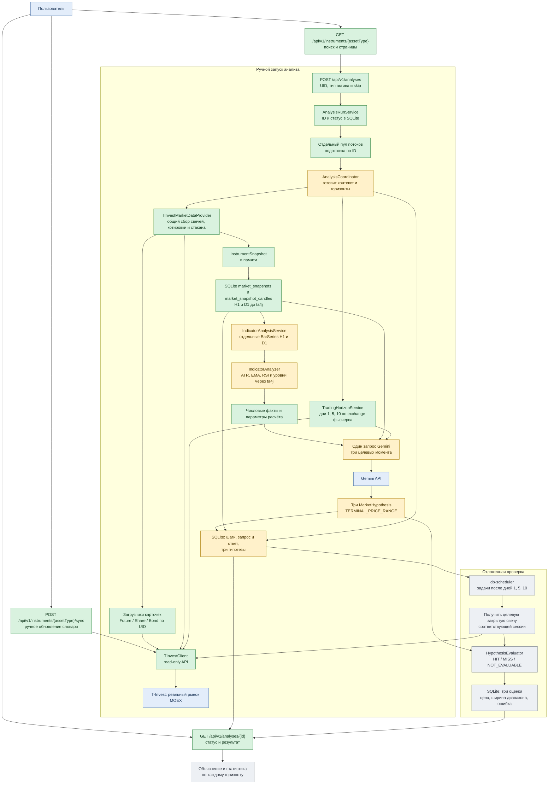

# Centaur Trading: целевой конвейер и текущее состояние

Срез кода на **17 октября 2026 года**. Схема показывает первый MVP: ручной анализ выбранного фьючерса MOEX, три прогноза диапазона цены закрытия на 1, 5 и 10 торговых дней и последующую проверку. Статус узла относится к **реализации в коде**, а не к готовности идеи в плане.

**Легенда:** зелёный — работает или есть готовый код для этой функции; жёлтый — есть каркас или прежняя реализация, которую ещё нужно включить в целевой поток; серый — запланировано, кода пока нет. Стрелка означает целевой поток данных или вызов. Сейчас весь путь от `POST` до оценки не работает сквозным образом.



## Точки входа

| Точка | Сейчас | Цель MVP |
|---|---|---|
| `AnalystApplication.main` | Запускает Spring Boot; запросов к T-Invest при старте нет. | Только запуск приложения и фоновых задач. |
| `FeatureAnalystController` (`/api/v1/features`) | Пустой контроллер без методов; вызвать анализ по HTTP нельзя. | Не является согласованной точкой входа для наблюдений. |
| `GET /api/v1/instruments/asset-types` | Возвращает поддерживаемые словарём типы инструментов: `SHARE`, `FUTURE`, `BOND`, `DFA`. | Заполнить выбор типа инструмента в UI. |
| `GET /api/v1/instruments/FUTURE?query=...&page=0&size=20` | Ищет инструменты обязательного `AssetType` в локальном словаре T-Invest по тикеру, названию или ID. Возвращает страницу паспортов с общим числом совпадений; размер страницы до 50. | Единый источник кандидатов для выбора инструмента. |
| `POST /api/v1/instruments/FUTURE/sync` | По ручному запросу читает полный список T-Invest и атомарно заменяет записи выбранного типа; отсутствующие в ответе инструменты исчезают из словаря. Успешный ответ — 204, ошибка API или БД прерывает запрос. Для `CURRENCY` и `CRYPTO` возвращает 400. | Обновить кандидатов перед выбором инструмента. |
| `POST /api/v1/analyses` | Принимает `providerId`, `assetType` (`FUTURE`, `SHARE`, `BOND`) и необязательный `skip`; сохраняет ID и запускает подготовку в отдельном пуле. Для `FUTURE` без `FORECAST` затем запрашивает три прогноза у Gemini. Возвращает `202`, ID, текущий статус и `Location`. | Позже назначить отложенную оценку прогнозов. |
| `GET /api/v1/analyses/{id}` | Читает из SQLite статус `CREATED` / `PREPARING` / `PREPARED` / `FORECASTING` / `FORECASTED` / `FAILED`, выбранный `skip`, времена, ошибку, горизонты и сохранённые метрики. | Позже показать оценки трёх горизонтов. |
| `GET /api/v1/analyses/{id}/steps` | Возвращает журнал подготовки и Gemini: начало и завершение шагов, входные и выходные данные либо ошибку. | Позже добавить шаги оценки горизонтов. |
| `GET /api/v1/analyses/{id}/forecast` | Возвращает сохранённый запрос и ответ LLM, `model`, `finishReason`, `usage`, исходный `content`, ошибку валидации и три гипотезы, если они приняты. | Позже добавить результаты оценки прогнозов. |
| `db-scheduler` | Зависимость и задачи отсутствуют. | Возобновлять отложенные проверки после перезапуска. |

## Что можно использовать уже сейчас

- `TInvestClient` читает справочник, свечи, котировки, стакан и расписание; токен приходит из `T_INVEST_TOKEN`. Есть проверка TLS по `tbank.ru.pem` и ограниченные повторы при HTTP 5xx/таймаутах. Методов выставления заявок нет.
- Словарь сохраняет UID, FIGI и `exchange` при синхронизации доступных типов инструментов; поиск работает по локальной SQLite и не вызывает T-Invest. Уникальный ключ — провайдер и UID: тикеры могут повторяться, а выбранный инструмент находится по UID. Замена ограничена парой провайдер/тип и проходит в одной транзакции; пустой ответ провайдера очищает этот тип. У DFA FIGI и `exchange` отсутствуют в ответе провайдера. Старые записи после миграции имеют пустые FIGI/`exchange` до следующей синхронизации словаря.
- `TInvestMarketDataProvider` через `MarketDataProvider` собирает `InstrumentSnapshot` из API. Загрузчики для фьючерса, акции и облигации получают актуальную карточку по UID без обращения к локальному словарю. Провайдер запрашивает H1 не глубже 30 календарных дней (до 120 закрытых свечей) и D1 не глубже 150 дней (до 100 закрытых свечей). Каждый `TInvestCandleData` хранит один таймфрейм и исходные `Quotation`, без преобразования цен в `double`. Котировка и стакан общие для запуска. Для акций и облигаций правила прогноза ещё не согласованы.
- `IndicatorAnalysisService` после записи снимка строит отдельные `BarSeries` с `DecimalNum` для H1 и D1. `AtrAnalyzer` рассчитывает ATR(28) в пунктах и процентах от последнего закрытия; `EmaAnalyzer` рассчитывает EMA(20/50), их разницу, отклонение закрытия от EMA20 и изменение EMA20 за пять свечей; `RsiAnalyzer` рассчитывает RSI(14) и его изменение за пять свечей; `LevelAnalyzer` рассчитывает rolling High/Low(50) и последние подтверждённые Swing High/Low по правилу 2/2. Каждый индикатор при недостатке своей истории пропускается без остановки остальных. `LiquidityAnalyzer` рассчитывает спред, его отношение к mid-price и к H1 ATR при его наличии, видимую глубину и её дисбаланс по одному сохранённому снимку стакана. `MarketAnalyzer` сохраняет значения текущего рыночного ответа и разницу между последней ценой и ценой закрытия из API, без вывода о статусе торгов.
- `AnalysisRunService` сначала записывает запуск с UUID и выбранным `skip` в SQLite, затем передаёт `AnalysisCoordinator.prepare(...)` в отдельный ограниченный пул потоков. После сохранения метрик запуск фьючерса с прогнозом сразу получает `FORECASTING`, а после одного вызова Gemini на три горизонта — `FORECASTED`. Запуск без прогноза завершается в `PREPARED`. При ошибке ставится `FAILED`, а прерванные при перезапуске запуски помечаются `FAILED`; завершённый `PREPARED` сохраняется. Акции и облигации пока завершают только подготовку в `PREPARED`; отложенные проверки ещё не подключены.
- `AnalysisCoordinator.prepare(...)` запрашивает снимок у провайдера, сохраняет его через `MarketSnapshotDao` в отдельной транзакции и только затем вызывает расчётный сервис. После этого рассчитывает горизонты 1/5/10 по `exchange` и возвращает `AnalysisPreparation`.
- `TradingHorizonService` вычисляет даты 1, 5 и 10 будущих торговых дней по расписанию MOEX. T-Invest отклонил запросы за пределами ближайшего 14-дневного окна, поэтому сервис запрашивает только текущую дату и следующие 13 календарных дат. Ответ может называть площадку иначе, чем карточка инструмента: при ровно одном расписании сервис использует возвращённые торговые дни и его имя, не требует буквального совпадения строк. Если в опубликованном расписании нет десятого будущего торгового дня, подготовка завершается с явной ошибкой без вызова Gemini. Правило для такого случая требует отдельного решения: нельзя незаметно заменить горизонт другой датой. Проверка экспирации конкретного контракта и сохранение выбранного расписания относятся к будущему координатору анализа.
- SQLite и Liquibase уже подключены; `analysis_runs.skip_json` хранит выбранные пропуски, а `methodology_version` — версию правил сбора. `market_snapshots` хранит общий неизменяемый снимок, `market_snapshot_candles` — исходные свечи отдельно по H1 и D1. `analysis_metrics` хранит версионированные факты отдельно для H1, D1 и общих рыночных данных; запись метрик, горизонтов и статуса `FORECASTING` либо `PREPARED` выполняется в одной транзакции. `analysis_steps` хранит вход, выход, время и исход выполненных шагов подготовки и Gemini. `llm_exchanges` сохраняет полный сериализованный запрос, полученный ответ, его метаданные и исходный `content`; `market_hypotheses` сохраняет три валидированных диапазона. Таблицы оценок ещё нет.

Для локальной проверки расчётов во время закрытых торгов можно вызвать `POST /api/v1/analyses` с таким телом:

```json
{
  "providerId": "uid",
  "assetType": "FUTURE",
  "skip": ["MARKET_TICK", "ORDER_BOOK", "FORECAST"]
}
```

`skip` отсутствует или равен `null` — выполняется обычный сценарий. `MARKET_TICK` убирает запрос текущих рыночных значений и `MarketAnalyzer`; `ORDER_BOOK` убирает запрос стакана и `LiquidityAnalyzer`; `FORECAST` убирает вызов Gemini. Свечи, сохранение снимка, технические расчёты и определение горизонтов выполняются всегда. Пропущенные части сохраняются в записи запуска; отсутствие котировки и стакана отражается в снимке как `null`. В этом режиме успешный запуск имеет конечный статус `PREPARED`.

## Границы целевого MVP

Если до вызова Gemini нельзя определить любой из трёх целевых дней или контракт истекает слишком рано, анализ завершается без прогноза. Для каждого горизонта целевой момент — конец основной сессии нужного торгового дня. На следующий календарный день Java ищет завершённую свечу **этой же торговой сессии**. Отсутствие свечи после прогноза даёт `NOT_EVALUABLE` только соответствующему горизонту; остальные проверяются независимо.

Реальные заявки, торговый счёт, исторический backtest и непрерывный опрос стакана в этот конвейер не входят. Подробные правила — в [плане MVP](mvp-development-plan.md) и [протоколе проверки](testing.md).
