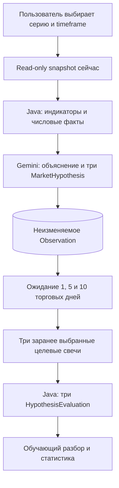

# Centaur Trading: архитектура исследовательского наставника

Схема целевого конвейера с точками входа и фактическим статусом реализации находится в [project-pipeline.md](project-pipeline.md).

Centaur наблюдает текущий рынок выбранной пользователем серии фьючерса MOEX, объясняет рассчитанные Java индикаторы и сохраняет три прогноза Gemini о диапазоне цены закрытия на **1, 5 и 10 торговых дней MOEX**. После закрытия заранее определённых целевых свечей Java сравнивает их фактические `close` с соответствующими диапазонами. Исторического backtest, реальных заявок и автоматического выхода из позиции нет. Стакан сохраняется **на момент анализа** как часть исходных фактов; непрерывный опрос стакана не нужен для основного сценария.



## Модель

- `InstrumentSpec`: конкретная серия, UID/код, экспирация, базовый актив, валюты, шаг и стоимость шага, расписание и источник. Серии не склеиваются без явного решения.
- `MarketSnapshot`: сохранённые использованные Bid/Ask и объёмы, рассчитанные индикаторы, параметры расчёта, времена биржевого события, получения и решения, источник и статус качества. Последние 200 пригодных свечей сохраняются как неизменяемый исходный ввод; `BarSeries` ta4j строится из них в памяти и не сериализуется. Это позволяет повторить расчёт по идентичным использованным значениям без хранения остального ответа API.
- `Observation`: анализ конкретной серии и момента `snapshotCapturedAtUtc`, зафиксированное расписание, три торговых горизонта и целевых момента, правило выбора свечей и технический статус. Рекомендация, если есть, хранится отдельно от качества прогноза.
- `MarketHypothesis`: три гипотезы типа `TERMINAL_PRICE_RANGE` на один снимок, каждая привязана к горизонту и содержит нижнюю/верхнюю границы будущего `close`, аргументы, альтернативу и источники неопределённости. После записи не меняется.
- `HypothesisEvaluation`: отдельная оценка `HIT`, `MISS` или `NOT_EVALUABLE` для каждого горизонта; фактический `close`, ширина диапазона, величина промаха, время и источник данных.

Один вызов Gemini получает **структурированные числа** с единицами, параметрами, timeframe, временем доступности и источником, а также три вычисленных Java горизонта и целевых момента. Текстовые фразы — производное объяснение. Модель не вычисляет индикаторы, не меняет горизонты и не назначает исходы. Java проверяет наличие и корректность трёх `TERMINAL_PRICE_RANGE`; событийные правила отложены. Точный промпт и Schema обсуждаются в следующей итерации. Диапазоны не являются гарантией или откалиброванными доверительными интервалами.

Концептуальный ответ Gemini, не окончательная Schema:

```json
{
  "marketInterpretation": {
    "evidence": ["EMA20 > EMA50"],
    "uncertainties": ["продолжение не гарантировано"]
  },
  "hypotheses": [
    {"tradingDays": 1, "type": "TERMINAL_PRICE_RANGE", "forecast": {"lowerBound": "14100", "upperBound": "14800"}},
    {"tradingDays": 5, "type": "TERMINAL_PRICE_RANGE", "forecast": {"lowerBound": "13800", "upperBound": "15100"}},
    {"tradingDays": 10, "type": "TERMINAL_PRICE_RANGE", "forecast": {"lowerBound": "13600", "upperBound": "15500"}}
  ],
  "recommendation": "WAIT",
  "learningNotes": ["Как читать сочетание показателей"]
}
```

Путь реализации: `SnapshotAssembler` → `FeatureCalculator`/`FactEnvelope` → `DecisionProvider` → `HypothesisValidator` → immutable journal → `HypothesisEvaluator` → отчёт. В MVP запуск через HTTP `POST` возвращает ID анализа; `GET` по ID показывает ход и результат.

## Когда нужен стакан

На момент ответа он помогает описать текущий спред, доступные объёмы и качество рынка. Каждый прогноз диапазона `close` проверяется по своей целевой закрытой свече. Для этого не нужны промежуточные снимки стакана. После горизонта можно сохранить ещё одну текущую котировку для сравнения начальных и конечных условий, но она не подменяет цену закрытия целевой свечи.

Непрерывная история стакана понадобится лишь для отдельного вопроса: как менялся спред/глубина и по каким ценам могла бы исполняться виртуальная сделка с внутрипериодными стопами. Это не обязательная задача наставника. Даже полный журнал лучших котировок не доказывает исполнение по ним. Если позже добавить условную виртуальную сделку «держать до горизонта», достаточно явно выбранных двух моментов и модели издержек; результат нельзя называть фактически заработанной прибылью.

## Время и результат

Каждое значение в запросе Gemini должно быть доступно не позже `decisionAtUtc`; незакрытые свечи не считаются окончательными. Время получения данных, отправки запроса и отложенной оценки различаются. Хранить ID/hash сохранённых фактов, полный запрос и ответ, model ID/version, prompt/schema, параметры и версии расчётов. `temperature=0` и `seed` не гарантируют побитовую повторяемость.

Жизненный цикл `CREATED → SNAPSHOT_CAPTURED → ANALYZED → AWAITING_HORIZON → COMPLETED`, с техническим `FAILED` при сбое. `HIT`, `MISS` и `NOT_EVALUABLE` — исходы оценки каждого горизонта. Worker после перезапуска продолжает ожидание и оценку идемпотентно, не пересоздавая гипотезы. Отчёт показывает аргументы, диапазон, фактический `close`, ширину, промах и неопределённость отдельно по каждому горизонту, число запусков и число оценённых прогнозов. Новости/новостной агент, портфельные метрики и автоматическая торговля вне MVP.
